

<a href="https://github.com/ShahzadAhmedAwan">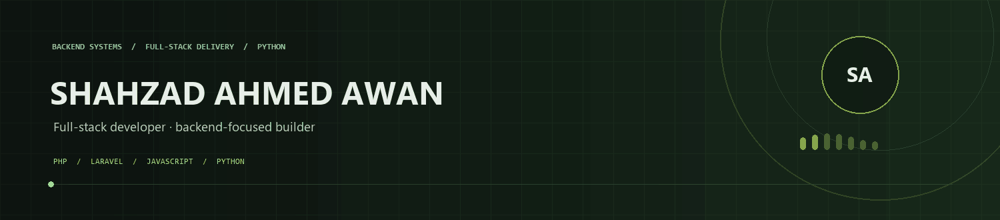</a>

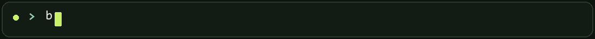

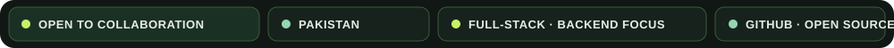

 

<a href="#about">ABOUT</a> &nbsp; · &nbsp;
<a href="#focus">FOCUS</a> &nbsp; · &nbsp;
<a href="#toolkit">TOOLKIT</a> &nbsp; · &nbsp;
<a href="#selected-work">WORK</a> &nbsp; · &nbsp;
<a href="#github-activity">ACTIVITY</a> &nbsp; · &nbsp;
<a href="#connect">CONNECT</a>

---

## About

<table>
<tr>
<td width="36%" valign="middle">

### Design-minded. Backend-first.

I build reliable digital products, connecting thoughtful interfaces to the systems behind them.

</td>
<td width="64%" align="center" valign="middle">

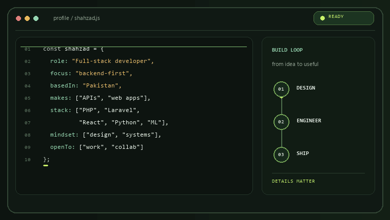

</td>
</tr>
</table>

## Focus

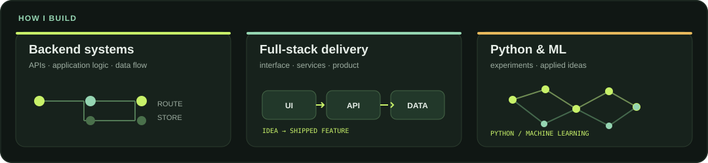

## Toolkit

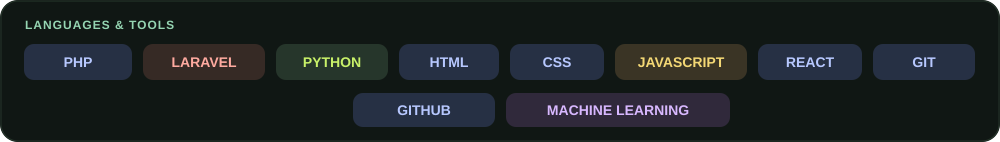

## Selected work

<a href="https://github.com/ShahzadAhmedAwan?tab=repositories">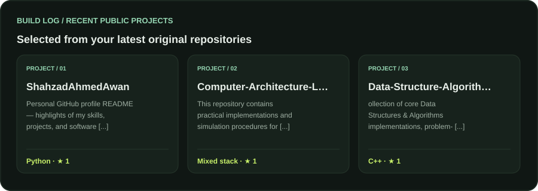</a>

<a href="https://github.com/ShahzadAhmedAwan?tab=repositories"><b>ALL REPOSITORIES ↗</b></a>

## GitHub activity

<a href="https://github.com/ShahzadAhmedAwan">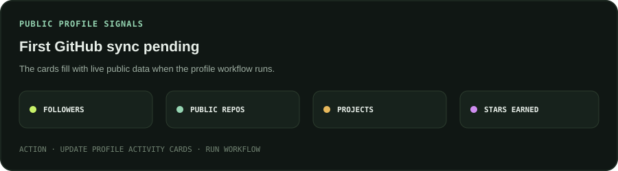</a>

<a href="https://github.com/ShahzadAhmedAwan?tab=repositories">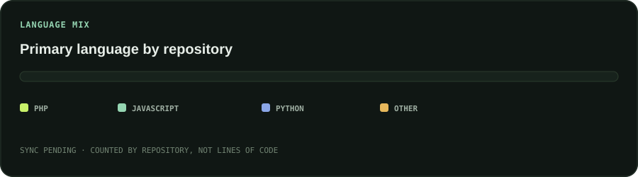</a>

<a href="https://github.com/ShahzadAhmedAwan">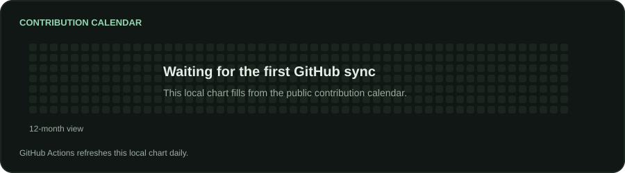</a>

<a href="https://github.com/ShahzadAhmedAwan/ShahzadAhmedAwan/actions/workflows/update-profile-assets.yml">SYNC THE CARDS ↗</a>

<b>Stats source &amp; refresh</b>

Profile totals and project cards use GitHub’s public user/repository data; language mix counts each repo’s primary language; the graph reads the public contribution calendar. Actions writes these as local SVGs on push and refreshes them daily. If a card says **SYNC PENDING**, open [Update profile activity cards](https://github.com/ShahzadAhmedAwan/ShahzadAhmedAwan/actions/workflows/update-profile-assets.yml) and choose **Run workflow**.

## Connect

<a href="https://github.com/ShahzadAhmedAwan">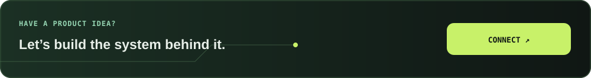</a>

